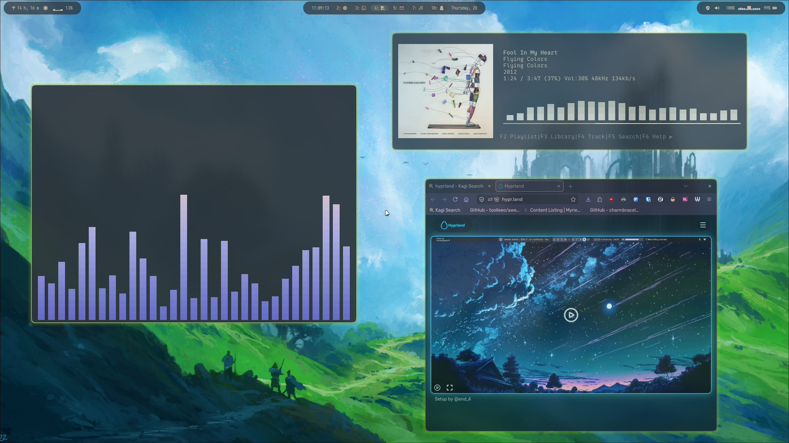

Dotfiles for both windows and linux. Uses bootstrap scripts and symlinks for
setting up the environment.



## Usage

Clone repo and run boostrap script. Note that the W11 version needs admin
to create the symlinks.

``` bash
git clone https://git@github.com/andfroswe/dotfiles ~/.myconf
cd ~/.myconf
./bootstrap.sh
```

If running for Arch, run in terminal before opening Hyprland, otherwise a Hyprland will lose the config until reboot.

Or for windows, do the same but run

``` pswh
./boostrap.ps1
```

## Features

Where possible cross platform apps and services are used.

On windows, does its best to get a decent tiling experience.

On Arch, customizes loads of stuff (wofi, mako, hyprlock etc).

## Dependencies

There are a bunch of stuff that are nice to have to get good customization. Firstly:

### Needed

#### Hypr-stuff and integrations

Hyprland has some nice modules that are needed in this configuration. Download and restart hyprland.

``` bash
yay -S hyprshot hypridle hyprlock hyprpaper clipse dolphin kitty mako wofi
```

#### Waybar

Wifi is controlled via NetworkManager and visible via nm-applet. Similarly, PipeWire with WirePlumber uses pavucontrol.

``` bash
yay -S network-manager-applet pavucontrol
```

### Nice to have

#### App toolkit themes

The color schemes are generated using [matugen](https://github.com/InioX/matugen). To update colors from a wallpaper for examples, just run

```bash
matugen image /path/to/wallpaper.jpg
```

and matugen will update the corresponding color files automatically. Use qt6ct-kde for Qt colors and GTK3/4 with their normal gsettings, using among others adw-gtk-theme, breeze-icons and darkly-bin.

Remember that the GTK settings can be set with gsettings, e.g.

```bash
gsettings set org.gnome.desktop.interface color-scheme prefer-dark
```

#### Cursor customization

Cursor customization was easy, following [this](https://blog.nicoandres.dev/change-your-cursor-in-arch-hyprland/) guide.

``` bash
git clone https://gitlab.com/Pummelfisch/future-cyan-hyprcursor.git ~/.config/future-cyan
cp ~/.config/future-cyan/Future-Cyan-Hyprcursor_Theme ~/.local/share/icons/Future-Cyan -r
``` 

The rest is already in the environment part of the dotfiles.
